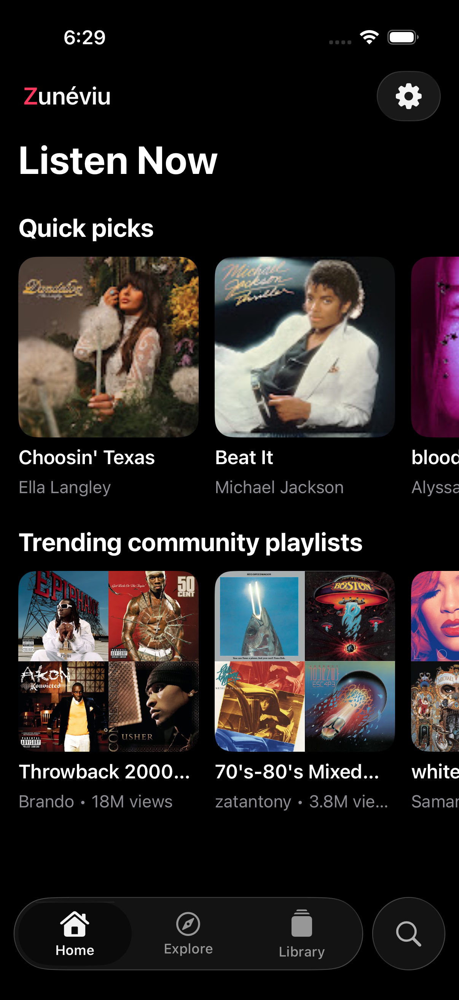

# Zunéviu for iOS — tested development subset, not full Android parity

**Status: incomplete native port, NOT a working Android-equivalent release.**

Version 0.4 development targets **iOS 15.0+**. It retains the Android-shaped split floating dock, native iOS 26 Liquid Glass and an earlier-iOS translucent material fallback.

New implementation in 0.4 (runtime results are recorded in `BUILD_STATUS.md`):

- Explicit opt-in **JioSaavn** source ported from Android: separate source-labelled search, direct native audio resolution, no silent substitution of a YouTube recording.
- Real progressive-file download queue: Wi-Fi policy, progress, cancellation/retry, full playable-audio/duration validation, transactional library installation and local playback. No persisted signed media URLs.
- Device-local discovery: 20-second qualified listening, eight seeds, round-robin dedup/exclusions, persisted metadata and reset. JioSaavn uses artist-search candidates; YouTube uses radio candidates. Neither is account-personalized recommendation.
- Functional audio-quality, download, playback, appearance, motion/blur/cache, lyrics, source and privacy controls instead of placeholder-only Settings sections.
- Separate fixture/offline regression and real-provider playback/download/offline acceptance tests.

**Not a 100% Android-equivalent release.** YouTube native audio remains blocked in its previous live acceptance test. Google/Spotify sign-in/sync, video, DSP/equalizer/smart transitions, advanced integrations and private modules are not ported. Downloading requires a source that actually supplies a full progressive file; background completion and HLS/DASH offline packaging are not implemented.

Actual iOS 15 runtime and physical iPhone acceptance have **not** run. An unsigned IPA requires Apple signing/provisioning before installation. Source or a successful build is not the same as a signed App Store/TestFlight release.

See [Android declaration-level coverage](docs/ANDROID_PARITY.md), `BUILD_STATUS.md` and the versioned validation records for exact scope, tested commit and limitations. Version 0.3’s verified results below remain historical; current 0.4 results are provider- and test-specific.

The owner requested an iOS version retaining the Android app's design. This archive contains an initial SwiftUI/AVPlayer implementation and an Xcode project, with test code and a macOS CI workflow. Xcode Simulator runtime evidence is linked in `BUILD_STATUS.md`; the earlier static checks remain in `STATIC_VALIDATION.json`.

## Version 0.4 verification

Real optional-source playback/download/local-file acceptance passed in run [39563210602](https://github.com/amitsami/zuneviu-ios/actions/runs/39563210602). Full compatibility run [39565266711](https://github.com/amitsami/zuneviu-ios/actions/runs/39565266711) passed 49 offline + 10 fixture UI + 1 real-source method in each environment. Later source-labelled real playback UI passed [39571506930](https://github.com/amitsami/zuneviu-ios/actions/runs/39571506930).

The latest compact-player fix is under full retest; do not apply earlier passes to untested later changes. `BUILD_STATUS.md` retains failed attempts, tested commits, current pending runs and package limitations.

## Reference

- Original repository: https://github.com/amitsami/zunevio-releases
- Source inspected at commit `4ba49d58de1b2699b9c948ec0d0c911e05ea0ab0`.
- Reference gallery: `assets/gallery/discover.png`, `listen.png`, `settings.png` in that repository.
- The original shared network/UI implementation uses JVM/Android dependencies, not an existing iOS target. This is a separate native implementation, not a claim that Android code now builds unchanged for iOS.
- Original monochrome music-mark branding was reused. Artist covers are not bundled. Catalog artwork is loaded from the provider; imported audio can supply its own embedded artwork.

## Version 0.3 verification

Run: https://github.com/amitsami/zuneviu-ios/actions/runs/39554273435

Actual iOS 26.2 guest Home screenshot below: **UI evidence, not streaming proof**.



The separate manual `glass-compatibility.yml` workflow tests both glass paths,
44pt targets, footer safe areas, mini-player separation, navigation, a legacy-
compatible playlist sheet, reduced motion/transparency and large text. It does
not produce a signed release or bypass live-provider acceptance.

## Added in version 0.2 — validation is separate from implementation

- WEB_REMIX configuration bootstrapped from the actual service shell, not a guessed fixed client version.
- Real guest Listen Now/Explore shelves, online song search, continuation requests and album/artist/playlist browse targets.
- Remote album artwork, stable video-to-track identities, saved online favorites/playlists/history.
- Pinned YouTubeKit native extraction with **local-only** methods. Optional hosted remote proxy is disabled.
- Candidate filtering for native codecs; actual media-byte probe before passing a URL to AVPlayer.
- Cancelable asynchronous resolution, visible loading/error/retry, no persisted signed media URLs.
- Song radio and provider plain-lyrics requests; imported synced LRC remains supported.
- Remote-song sharing uses the public song link, not an invalid local file path.
- Backward-compatible decoding of version 0.1 local libraries and separate on-device/saved-online collections.
- Separate real-provider acceptance tests for catalog, search UI, native audio clock advancement, pause, seek and next.

**Implementation is not a runtime pass.** In particular, provider streaming is blocked until its live acceptance test passes.

## Existing local functionality — selected version 0.1 behavior verified by Simulator tests

- Native Listen Now, Explore, Library, Search and Settings navigation.
- Files import, app-sandbox copies, embedded title/artist/album/artwork extraction.
- Local AVPlayer playback, scrubbing, previous/next, shuffle, repeat and queue.
- Background audio declaration, Now Playing metadata and remote transport handlers.
- System volume and AirPlay route controls.
- Favorites, playlists, recent history, locally measured listening time and JSON persistence.
- Remove an imported copy without deleting the original Files document.
- UTF-8 `.lrc`/`.txt` import, timed lyrics, lyric seeking and timing offset.
- Sleep timer, playback speed and dark/light/system theme settings.
- An explicit first-run development/feature-limit notice, rather than a fake connected streaming library.

## Not implemented / not equivalent to Android

- Google/YouTube Music and Spotify authentication, sessions, library sync and acceptance flows.
- Reliable YouTube native audio: its previous live extraction gate is failing. JioSaavn has a separate explicit source path and acceptance gate. Background-restorable downloads and manifest packaging are not implemented.
- Music video and Genius/timed online lyric parity. Radio, provider search, plain lyric and artwork requests are implemented but must be validated separately.
- Android equalizer/DSP, PCM output controls, smart transitions/crossfade, stem separation.
- Listen-together/party, WebDAV, provider integrations and Android APK update machinery.
- Full settings parity, localization, Android library migration and pixel-identical visual certification.

Unavailable features are identified as such in Settings. No decorative switches pretend to implement them.

## Optional JioSaavn source

In **Settings → Sources**, enable **JioSaavn catalog** (off by default, as in Android). Open Search, choose Online and select JioSaavn. Search results retain their own catalog identity and are not used to silently replace YouTube selections. Long-press/Options → Download queues a song; Library → Downloads shows actual completion or failure. Only completed, validated files become on-device audio.

Requests go directly to JioSaavn and its CDN. Android’s location-spoofing headers are deliberately not copied. No private account configuration, remote plugin, geographic bypass, shared cookies or extraction proxy is used. Availability and distribution remain subject to provider rules and regional restrictions.

## Open and run on a Mac

Requirements: full Xcode 16 or newer, installed iOS Simulator runtime, iOS 15.0+ deployment target (Xcode 26.2 for native iOS 26 Liquid Glass). Swift Package Manager resolves YouTubeKit at pinned revision `e5b7d0396ce12bf3444f0d209e8436c83373b7af`. No CocoaPods or XcodeGen is required. Guest catalog calls do not require credentials; authentication/sync is not implemented.

1. Open `Zuneviu.xcodeproj`.
2. Choose the shared **Zuneviu** scheme and an installed iPhone simulator.
3. Build/run. On first launch, read the development notice. Home attempts the real guest catalog; Library still supports importing audio from Files.
4. For a physical iPhone, set **Signing & Capabilities → Team** and choose an available bundle identifier. Apple signing/provisioning is required; this archive supplies no signing secrets.

The iOS code is kept separately in `amitsami/zuneviu-ios`; the Android release repository is not modified. GitHub authorization is used only outside the source tree. No credential is included in this repository.

## Run the actual iOS tests

```sh
./scripts/test_on_mac.sh
```

Or use Xcode's **Product → Test**. The project now includes 28 offline unit/integration methods, 7 fixture UI methods, 2 real-provider integration methods and 1 real-search UI method. The **old** version 0.1 passed 15 local tests in runs 39458769222 and 39459965095. Those results do not apply to the newly added code. Real-provider failures must remain failures, not be relabeled as environment passes. See `TEST_PLAN.md` for coverage and limitations.

The script writes a timestamped `.xcresult` and log into `TestResults/`. It exits unsuccessfully if Xcode tests fail. No report in this archive substitutes for those runtime results.

### GitHub Actions

The included `.github/workflows/ios.yml` is manual-only (`workflow_dispatch`), runs on `macos-15` with a 25-minute job timeout, builds the app, executes the tests on an available iPhone simulator, and uploads `.xcresult`/logs with one-day retention. Pushing code does not automatically start a billable run. The simulator app is uploaded after offline regression success; that alone is NOT online playback acceptance. The current IPA delivery step additionally requires the live-provider gate to succeed. A simulator `.app` is **not** an installable iPhone IPA. The initial Simulator workflow successfully ran in this repository. The expanded workflow successfully built an unsigned iPhone IPA and captured a real Simulator screenshot in run 39459965095. That historical version 0.1 IPA is an arm64 iOS device build for iOS 17+, not a Simulator binary. Its SHA-256 and build provenance are in `BUILD_EVIDENCE.json`.

Place the archive contents at the root of a new repository, or adapt paths and workflow triggers if placing it under a subfolder in an existing repository. GitHub-hosted macOS runners require account/repository access and may incur charges; only standard public-repository runners are used; no paid/larger runner is selected.

## Re-run static checks

```sh
python3 -m pip install -r scripts/requirements-static.txt
python3 scripts/verify_project.py
bash -n scripts/test_on_mac.sh
```

The verifier parses Swift syntax with Tree-sitter, not Apple's Swift compiler. It also parses the Xcode project, checks references, plists, scheme, assets and fixture WAV. A static pass cannot establish API availability, Swift type checking, linker correctness, UI behavior or audio behavior.

After adding/removing Swift files, regenerate the explicit Xcode project with:

```sh
python3 scripts/generate_project.py
```

## Storage and privacy

Audio imports copy into `Library/Application Support/Zuneviu/`. Originals are not modified. Metadata and playlists are in `library.json`; imported artwork and lyrics sit beside the copied music. Corrupt manifests are not overwritten by a scene-save. The app has no analytics or embedded sign-in. Online catalog/search, media resolution/playback, artwork and lyric requests contact YouTube/Google directly. Optional remote extraction proxies are disabled. Search terms and playback requests therefore leave the device; local imports/favorites/playlists/history are stored in the sandbox. System Files/iCloud, sharing, device backup and AirPlay retain their own platform behavior. Deleting the app deletes this sandbox.

`TestTone.wav` is an original generated 8-second 440 Hz tone for tests. The debug-only `--ui-testing` launch flag creates an isolated test library, not the user's normal library. It is not a demo of provider streaming.

## License

GPL-3.0; see `LICENSE`. Original branding and source references retain attribution in `UPSTREAM-NOTICE.md`. `UPSTREAM-THIRD-PARTY-NOTICES.md` is retained historical context for the Android app, not a declaration that all Android dependencies are linked into this SwiftUI target. The catalog parser/protocol is ported from the GPL Android source; original notices are retained. No AGPL smart-transition implementation or external music-provider credentials are included. YouTubeKit and its bundled resources retain their own upstream licenses.
